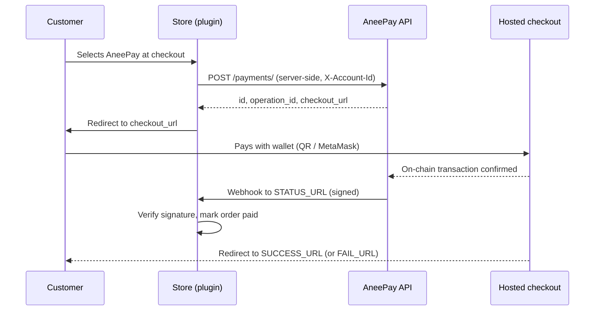

# CMS integrations

AneePay ships ready-made plugins for three e-commerce platforms. A plugin runs the
whole payment lifecycle for you: it creates the payment on the store server,
redirects the customer to hosted checkout, verifies the webhook signature, and
updates the order status — no blockchain code in your store.

## Supported platforms

| Platform                | Package                              | Guide                                  |
| ----------------------- | ------------------------------------ | -------------------------------------- |
| WooCommerce (WordPress) | `aneepay.zip`                        | [WooCommerce](woocommerce.md)          |
| OpenCart 3.x            | `aneepay-<version>.ocmod.zip`        | [OpenCart](opencart.md)                |
| PrestaShop 1.7 / 8      | `ps_aneepay.zip`                     | [PrestaShop](prestashop.md)            |

!!! note "Only these three platforms are supported"

    Shopware, Bitrix, Magento, and any other system are **not** covered by a
    dedicated plugin. For them, follow the [custom integration recipe](custom-integration.md)
    — it is exactly the flow the plugins implement, without the platform glue.

| Platform                | Minimum requirements                                     |
| ----------------------- | -------------------------------------------------------- |
| WooCommerce (WordPress) | WordPress 6.0+, WooCommerce 6.0+, PHP 7.4+               |
| OpenCart 3.x            | OpenCart 3.0.x, PHP 7.4+                                 |
| PrestaShop 1.7 / 8      | PrestaShop 1.7.0 or later, PHP 7.4+                      |

Pick the plugin for your platform; there is no generic "one plugin for all"
build. If your platform is not in this table, you implement the same flow
yourself — see [Custom integration](custom-integration.md).

## Common plugin flow

1. Install the plugin and enter the credentials from your AneePay account:
   **Account ID** (UUID), **Webhook Secret**, and the site domain.
2. The plugin settings page shows three store URLs — `STATUS_URL`, `SUCCESS_URL`,
   `FAIL_URL`. Copy them into the AneePay account panel.
3. At checkout the customer picks AneePay. The plugin converts the order total to
   the token amount and calls `POST /payments/` **from the store server**.
4. The customer is sent to the returned `checkout_url` and pays on the hosted
   payment screen.
5. After on-chain confirmation AneePay POSTs a signed webhook to `STATUS_URL`; the
   plugin verifies `X-AneePay-Signature` and marks the order as paid.
6. The customer lands back on `SUCCESS_URL` (or `FAIL_URL`). In parallel the store
   polls the API so a missed webhook cannot strand the order.
7. You reconcile payments with `GET /accounts/{account_id}/payments`.

## What is configurable

All three plugins expose the same core settings:

| Setting              | Purpose                                                                                  |
| -------------------- | ---------------------------------------------------------------------------------------- |
| Account ID           | Account UUID from the dashboard; sent as `X-Account-Id` on every API call.               |
| Webhook Secret       | Key for `X-AneePay-Signature` verification. Required — without it webhooks are rejected. |
| Site domain          | Host sent as `Origin`; must match the account `domain`. Defaults to the store host.      |
| Token / network      | `usdt`, `usdc`, or `dai` on `polygon` (live) or `amoy` (test).                           |
| Test (sandbox) mode  | Sends `?sandbox=yes`: Amoy network, USDC, `is_safe` bypass.                              |
| Exchange rate source | Auto rate (Frankfurter/ECB) with a manual fallback, or a manual rate only.               |
| Order status mapping | Which store status means pending, paid, failed, cancelled.                               |
| Status sync          | How often pending orders are polled when a webhook is missed.                            |

Platform-specific details and defaults:

- [WooCommerce](woocommerce.md)
- [OpenCart](opencart.md)
- [PrestaShop](prestashop.md)

## Amount conversion

Store currencies are usually not USD. A plugin converts **store total → USD →
token** using a live ECB rate (with store-rate and manual fallbacks) and rounds the
token amount **up** to two decimals, so the merchant never undercharges. The exact
amount the customer pays is shown on the payment method card at checkout. See
[Amounts and rounding](../payments/amounts-rounding-and-limits.md).

## What the plugins do not do

- No refunds, no customer cancellation, no subscriptions or recurring payments —
  see [Refunds and non-features](../payments/refunds-cancellations-and-non-features.md).
- No in-store (POS) payments.
- No x402. Pay-per-request APIs for AI agents are a separate integration — see
  [x402](../x402/index.md).

## Testing a plugin

Every plugin has a **Test mode** toggle. It creates payments on the Amoy testnet
with USDC and bypasses the `is_safe` check, while keeping real confirmations and
real signed webhooks. See [Sandbox](../sandbox.md).

## In this section

- [WooCommerce](woocommerce.md) — install, settings, checkout, order statuses.
- [OpenCart 3.x](opencart.md) — extension install, status mapping, cron.
- [PrestaShop 1.7 / 8](prestashop.md) — module install, order states, cron.
- [Custom integration](custom-integration.md) — the same recipe for any other site.
- [Plugin development](plugin-development.md) — security, packaging, versioning.
- [Troubleshooting](troubleshooting.md) — plugin-specific symptom → fix tables.

## Related sections

- [Account setup](../getting-started/account-setup.md) — the values you paste into a plugin.
- [Webhooks](../webhooks/overview.md) — what the plugin verifies and when.
- [Security best practices](../security/best-practices.md) — merchant checklist.
