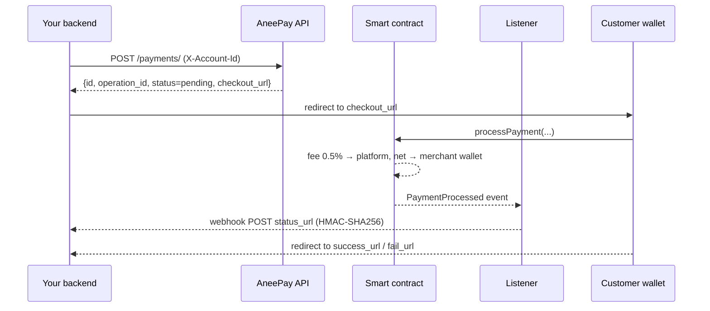

# Product overview

This page explains the AneePay payment model: where money moves, what the smart
contract does, what hosted checkout is, and what the product deliberately does
not do.

## The model in one paragraph

Your backend creates a payment through the JSON API. The customer is redirected
to a hosted checkout page, confirms the transaction in their wallet, and the
smart contract sends the amount — minus a flat 0.5% fee — straight to your EVM
wallet. AneePay never touches the funds: there is no balance to withdraw, no
custody, and no counterparty risk on our side.

## Actors

| Actor | Role |
| --- | --- |
| Your backend | Creates payments (`POST /payments/`), receives webhooks, reconciles. |
| Customer | Pays from their own wallet (MetaMask or any EIP-1993/EIP-6963 wallet) on the hosted page. |
| Hosted checkout (dApp) | AneePay-hosted page at `checkout_url`: QR code, MetaMask deep link, network switching, calls the contract. |
| Smart contract (`PolygonStandardPayment`) | Deducts the 0.5% fee on-chain and transfers the net amount to your wallet atomically. Emits `PaymentProcessed`. |
| Listener (AneePay backend) | Watches chain events, waits for finality, updates the payment status, and delivers the signed webhook to your `status_url`. |

## Payment flow

1. Your backend creates a payment: `POST /payments/`.
2. The API returns `id`, `operation_id`, `status: pending`, and `checkout_url`.
3. You redirect the customer to `checkout_url`.
4. The customer confirms the transaction in their wallet. The dApp calls
   `processPayment(operationId, token, amount, recipient)` on the contract.
5. The contract deducts the 0.5% fee and transfers the net amount to your
   wallet, then emits `PaymentProcessed`.
6. The listener receives the event, waits for confirmation, sets the payment
   status to `success`, and sends a signed webhook to your `status_url`.
7. The dApp redirects the customer's browser to your `success_url` or
   `fail_url`. You track the authoritative status via webhook or API polling.

## The role of the contract

The contract is the only component that moves money:

- `calculateAmounts(amountWei)` computes `feeAmount = amountWei * 0.5 / 100`
  and `netAmount = amountWei - feeAmount` with basis-point precision.
- `processPayment()` performs both transfers atomically: fee → platform,
  net amount → your wallet. If either transfer fails, the whole transaction
  reverts — there are no partial settlements.
- The contract emits `PaymentProcessed` with `operationId`, sender, recipient,
  token, amount, `feeAmount`, and `netAmount`. That event is what the listener
  uses to confirm the payment.

Contracts are built with OpenZeppelin (`ReentrancyGuard`, `Pausable`,
`SafeERC20`), and verified source is published on Polygonscan. Gas is paid by
the payer through standard wallet estimation; the 0.5% is the only platform fee.

## Hosted checkout

You never build a payment page. `checkout_url` renders a ready-made page that:

- shows a QR code and a MetaMask deep link;
- discovers the wallet via EIP-6963 multi-provider discovery (fallback to
  `window.ethereum`);
- switches the customer to the right network (Polygon 137 or Amoy 80002);
- checks balance and allowance, submits the transaction, waits for it;
- redirects the customer to your `success_url` or `fail_url`.

The authoritative confirmation still comes to **your** backend — via the signed
webhook or by polling `GET /payments/{id}`.

## What AneePay does not do

!!! danger "Non-features"
    These are not limitations to work around — they are absent by design.

- **No refunds.** Once a payment is `success`, it cannot be reversed through
  AneePay; handle refunds off-chain yourself.
- **No customer cancellation.** There is no cancel API, no cancel button, no
  cancellation webhook. If the customer does not pay, the payment stays
  `pending` or ends `failed`.
- **No subscriptions or recurring payments.** Every payment is one-off.
- **No custody.** AneePay has no merchant balances: funds never touch our
  servers. There is nothing to "withdraw".
- **No fiat.** Only USDT, USDC, DAI on Polygon (production) and USDC on Amoy
  (sandbox).
- **No KYC.** Onboarding is a domain safety check (see
  [Account setup](account-setup.md)).

## Fees and settlement

- Flat **0.5%** per successful payment, calculated and deducted on-chain.
- Fee and net amount are visible after on-chain confirmation — in
  `GET /payments/{id}` and in reconciliation lists — not at creation time.
- The webhook payload includes `fee` and `net_amount` so you can reconcile
  without re-deriving anything.

## Networks and tokens

| | Production | Sandbox |
| --- | --- | --- |
| Network | Polygon mainnet (chain ID 137) | Amoy testnet (chain ID 80002) |
| Tokens | USDT, USDC, DAI | USDC |
| How | default | `?sandbox=yes` when creating the payment |

Details, contract addresses, and decimals: see
[Networks, tokens, and fees](../payments/networks-tokens-fees.md)
(or the [Reference](../reference/index.md) section).

## Next steps

- [Quickstart](quickstart.md) — accept your first payment.
- [Account setup](account-setup.md) — domain, wallet, callbacks, webhook secret.
- [Payment lifecycle](payment-lifecycle.md) — statuses, confirmations, finality.
