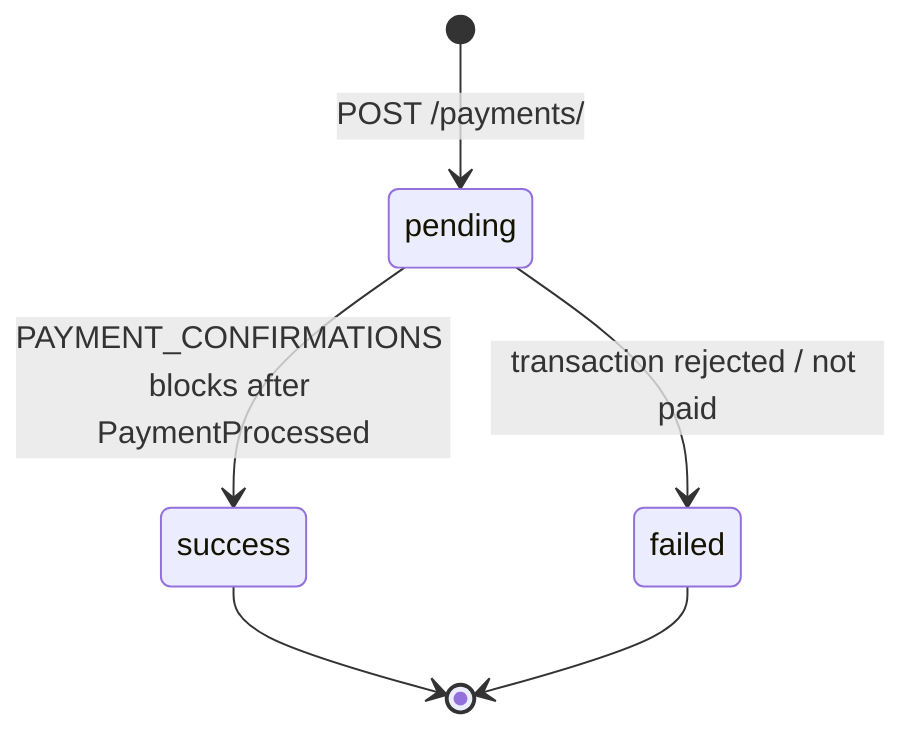

# Payment lifecycle

A payment is created as `pending` and ends in one of two terminal states.
This page describes the states, what moves a payment between them, and what
you can (and cannot) rely on.

## States



| Status | Meaning | Terminal |
| --- | --- | --- |
| `pending` | Created; waiting for the customer to pay and for on-chain finality. | no |
| `success` | Payment confirmed on-chain; webhook delivered. | yes |
| `failed` | Customer's transaction was rejected or never paid. | yes |

!!! note "`cancelled` is not a customer scenario"
    The database also contains a technical status `cancelled`, used only for
    admin/manual operations. It is **not** part of the public contract — never
    map it to a customer-facing flow.

## `operation_id`: the link between API and chain

Every payment UUID is encoded as a `uint128` integer for the smart contract:

```text
operation_id = int(payment_id)
```

The mapping is **bijective** — `uuid.UUID(int=operation_id)` always restores
the original `payment_id`. The chain only knows `operation_id`: it is stored in
the `PaymentProcessed` event and echoed back in the webhook. Keep it on your
order record; it is the primary key for matching webhooks and polling results
to your business entities.

## Confirmations and finality

1. The customer's transaction lands on Polygon and emits `PaymentProcessed`.
2. The listener persists a durable pending event (nothing is lost if a
   process restarts).
3. The listener waits until the transaction reaches **finality** —
   `PAYMENT_CONFIRMATIONS` blocks (default: **12** on Polygon).
4. Only then does the payment become `success`, and the webhook is written to
   a durable outbox for delivery.

So a payment can be visible on-chain and still be `pending` for a short while —
that is the confirmation window. On Polygon this is typically seconds; if you
poll, keep polling until `status` is terminal.

Fee and net amount (`fee`, `net_amount`) become visible at this point, in
`GET /payments/{id}` and in the webhook — they are not present at creation.

## What ends a payment as `failed`

If the customer never completes the transaction or their wallet rejects it,
there is nothing to confirm on-chain and the payment ends `failed`; the dApp
sends the customer to `fail_url`. A payment that is simply abandoned stays
`pending` until you decide how to handle it (e.g. expire orders in your own
system and create a new payment when the customer returns).

## No customer cancellation, no refunds

- There is **no cancel API and no cancel UI**. A customer cannot cancel a
  pending payment through AneePay; there is also no cancellation webhook.
- **No refunds.** Once `success`, the on-chain transfer cannot be undone by
  the platform. If you need to refund a customer, send funds back off-chain.

Details and rationale: [Refunds, cancellations, and non-features](../payments/refunds-cancellations-and-non-features.md).

## How you learn the status

| Channel | Direction | Notes |
| --- | --- | --- |
| Webhook to `status_url` | AneePay → you | Recommended. Sent **only** on transition to `success`, signed with `X-AneePay-Signature`. See [Webhooks](../webhooks/overview.md). |
| `GET /payments/{id}` | You → AneePay | Public polling endpoint (no auth header). Returns status, confirmation flag, timings, `network`, `is_sandbox`. |
| `GET /accounts/{account_id}/payments` | You → AneePay | Authenticated list with filters — for reconciliation, not for real-time status. |
| Browser redirect | dApp → customer | To your `success_url` / `fail_url`. Convenient, **not authoritative** — the customer may close the tab before it fires. |

!!! warning "Never fulfill on redirect alone"
    The redirect can be skipped, delayed, or faked. Ship goods or unlock
    content only after a verified webhook or a confirmed poll result.

## Sandbox flag

Sandbox payments (`?sandbox=yes`) run on Amoy with test USDC. Their webhooks
carry `network: "amoy"` and `is_sandbox: true`; the status endpoint returns
the same flags. Do not fulfill real orders when `is_sandbox` is `true`.
See [Sandbox](../sandbox.md).

## Next steps

- [Webhooks](../webhooks/overview.md) — payload, signature, retries.
- [Status and polling](../payments/status-and-polling.md) — endpoint details.
- [Glossary](glossary.md) — all terms in one place.
