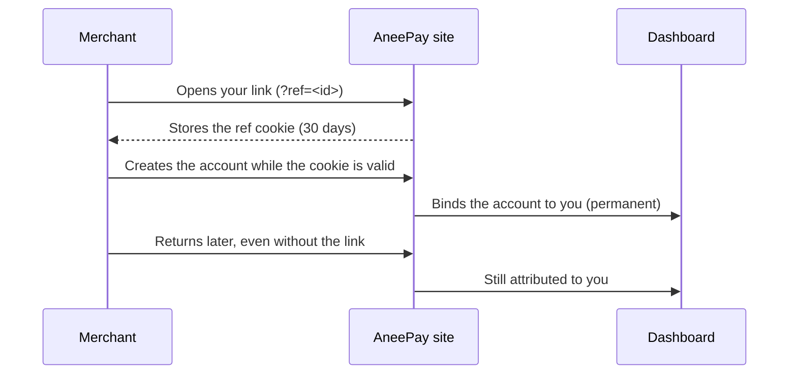

# Getting started

Four steps take you from an email address to a working referral link. The
whole flow is a few minutes; the only thing you need up front is an email
inbox.

## 1. Register with your email

Open [aneepay.com/partner/register](https://aneepay.com/partner/register/) and
enter your email address in the **Partner Program** form, then press
**Get Partner Link**.

- Registration is passwordless: there is no password to invent or store.
- If you already have an AneePay account for that email, registering creates
  the partner profile for it — you do not end up with two profiles.

!!! success "You will see this confirmation"

    `Partner login link sent. Check your email (Valid for 10 min).`

## 2. Confirm with the magic link

The message contains a one-time magic link. Open it within **10 minutes**.

| Property    | Value                                                        |
| ----------- | -----------------------------------------                    |
| Validity    | 10 minutes from the moment it was sent                       |
| Reuse       | Single use — opening it twice fails                          |
| Effect      | Activates the profile: `Pending` → `Active` and signs you in |

If the link has expired or was already used, you get the **Invalid Token**
page. Go back to step 1 and request a new one — registering again with the
same email does not create a duplicate partner profile.

## 3. Set up your payout wallet

After the first login you land on **Setup Your Wallet**. Add the **Polygon**
wallet address that should receive your DAI payouts.

- Any valid EVM address is accepted; it is stored checksum-normalized, so
  `0xab58…` becomes `0xAb58…`.
- An invalid address (too short, not hex) is rejected with a field error.
- You can register and confirm your email **before** you have a wallet
  ready — the dashboard simply stays locked until one is on file.
- The address is saved with one click; if you land on the form again it simply
  redirects you to the dashboard, so a saved wallet is not editable there. To
  move payouts to a different address, contact support.

!!! warning "No wallet, no withdrawals"

    Commissions keep accruing while your wallet is missing, but the
    **Withdraw to Wallet** button stays disabled until an address is saved.

## 4. Copy your referral link

Once your status is `Active` and a wallet is set, you are redirected to the
**Partner Dashboard**. The **Referral Link** card shows your link:

```text
https://<site-url>/?ref=<your-partner-id>
```

The `ref` value is your partner ID and never changes. Share the link
anywhere — an article, a community, a newsletter, a consulting engagement.

### How the cookie becomes attribution



Rules worth knowing before you share the link:

- The cookie lasts **30 days** and only the **first** link a visitor uses is
  stored — a second link does not overwrite it.
- The cookie alone attributes nothing: the merchant must **create the
  account** while it is still valid.
- Attribution is **first touch** and permanent. Another partner's link will
  not take the account away from you, and yours will not take it from them.
- Unknown, invalid, or not-yet-active partner IDs in `?ref=` are ignored.

## 5. Track and withdraw

Everything is on the **Partner Dashboard**:

| Card / counter        | Shows                                                          |
| -------------------   | -------------------------------------------------------------- |
| Your Info             | Status, wallet, your share of the fee                          |
| Referral Link         | Your permanent `?ref=` link                                    |
| Referred Merchants    | Accounts attributed to you                                     |
| Accrued / Paid        | Lifetime commission in DAI                                     |
| Payouts               | Number of payout transactions                                  |
| Available to Withdraw | Balance you can cash out right now                             |
| In 7-day hold         | Commissions from payments confirmed less than 7 days ago       |

See [Commissions and payouts](commissions-and-payouts.md) for how the numbers
are calculated and how a withdrawal works.

## Troubleshooting

| Symptom                                            | What to do                                                         |
| -------------------------------------------------- | -----------------------------------------------------------------  |
| No magic email                                     | Check spam, then request a new link from the registration page     |
| `Invalid Token` page                               | The link expired (10 min) or was already used — request a new one  |
| Dashboard redirects you back to registration       | Your profile is still `Pending` — confirm the magic link           |
| Dashboard redirects you to wallet setup            | Add a Polygon wallet address                                       |
| Withdraw button disabled                           | Balance is 0, or no wallet is on file — see the dashboard counters |
| A merchant signed up but is not in your count      | See [FAQ — attribution](faq.md#attribution)                        |

## Related sections

- [Commissions and payouts](commissions-and-payouts.md) — how the numbers are
  earned and paid.
- [FAQ](faq.md) — partner questions grouped by topic.
- [Merchant](../merchant/index.md) — what your referrals are signing up for.
