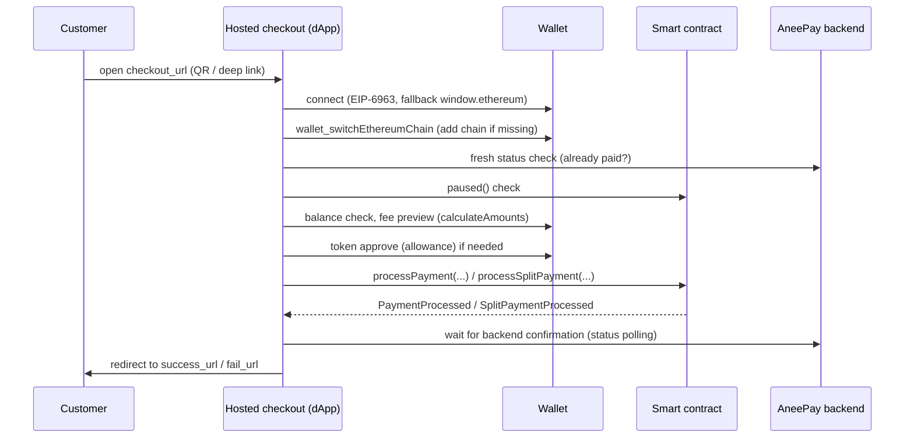

# Hosted checkout and dApp

`checkout_url` renders a payment page hosted by AneePay. The customer never
installs anything: they scan a QR code or open a MetaMask deep link, confirm
the transaction in their wallet, and are redirected back to your site.

## What the page shows

- The receiving **wallet** (`account.wallet`), the **amount**, and the payment
  **description** as a memo.
- A **QR code** (base64 PNG) and a MetaMask **deep link**
  (`https://metamask.app.link/dapp/…`) so the page opens inside the wallet app.
- A **Pay** button that drives the dApp flow below.

## Payment flow inside the dApp

Step by step:

1. **Wallet discovery.** The page announces itself via **EIP-6963**
   (multi-provider discovery) and accepts any announced provider, falling back
   to `window.ethereum`. If no wallet is found, it offers to open the page in
   the MetaMask app (deep link) or links to the MetaMask download page.
2. **Network switching.** The wallet is switched to the payment's network via
   `wallet_switchEthereumChain`, with `wallet_addEthereumChain` as fallback:

    | Network | chainId | RPC | Explorer |
    | --- | --- | --- | --- |
    | Polygon Mainnet | `0x89` (137) | `polygon-rpc.com` | polygonscan.com |
    | Polygon Amoy (sandbox) | `0x13882` (80002) | `polygon-amoy-bor-rpc.publicnode.com` | amoy.polygonscan.com |

    The native currency for gas is **POL**.

3. **Fresh status check.** Before anything is signed, the page fetches the
   current status from your `status_url`. If the payment is already `success`,
   the button locks ("already paid"); if `failed`, the flow stops.
4. **Gateway health.** The dApp calls `paused()` on the contract — while the
   gateway is paused, payments are rejected (the contract is `Pausable`).
5. **Balance and fee.** The token's `decimals()`/`symbol()` are read from the
   contract, the amount is converted to base units
   (`parseUnits(amount, decimals)`), the customer's balance is checked, and the
   0.5% fee is previewed with `calculateAmounts(amountWei)`.
6. **Allowance.** If the allowance to the payment contract is insufficient, the
   page requests an ERC-20 `approve` first; if it is already sufficient, that
   step is skipped.
7. **Contract call.** Gas is estimated (fallback limit 300 000), then the
   transaction is sent:
    - Standard payment (`payment_type: A`) → `processPayment(operationId, token,
      amount, recipient)`;
    - Split payment (`payment_type: B`) → `processSplitPayment(operationId,
      token, amount, recipients[], shares[])` to the split contract, with the
      approve routed to that contract.
8. **Receipt verification.** The page waits for the receipt, checks
   `status == 1`, finds the `PaymentProcessed` (or `SplitPaymentProcessed`)
   event for this `operationId`, and verifies that the token and amount match
   what was requested. For splits it additionally verifies `recipientsHash`
   against the recipients shown to the customer.
9. **Backend confirmation.** The page polls until the backend marks the payment
   `success` (the same confirmation chain your webhook receives —
   [finality](../getting-started/payment-lifecycle.md)).
10. **Redirect.** After confirmation the browser goes to your `success_url`.
    On errors it goes to `fail_url` (with a reason query parameter) — except
    for a customer-initiated wallet rejection, where a retry button is shown
    instead of redirecting.

## Things you cannot customize

The hosted page is a fixed product surface: amount, token, network, wallet,
description, and the two redirect URLs come from the payment and your account.
There is no theming or custom HTML on the checkout page; your branding lives
on `success_url`/`fail_url`.

## What the dApp does not do

- It does not change the amount, token, or recipient — those are fixed by the
  payment record at creation time.
- It does not cancel the payment; if the customer leaves without paying, the
  payment stays `pending`
  ([non-features](refunds-cancellations-and-non-features.md)).
- It never asks for seed phrases or private keys — only standard wallet
  connection and transaction prompts.

!!! warning "The redirect is not the source of truth"
    A customer can close the tab after paying (or never reach the redirect).
    Finalize orders from the signed webhook or a confirmed
    [status poll](status-and-polling.md).

## Native token (POL) is not accepted

The payment contracts accept **only ERC-20 tokens**. Sending native POL to the
contract address reverts (`NativeTokenNotAccepted`); an owner-only recovery
function exists for tokens sent by mistake. Gas is paid by the customer's
wallet in the usual way.
