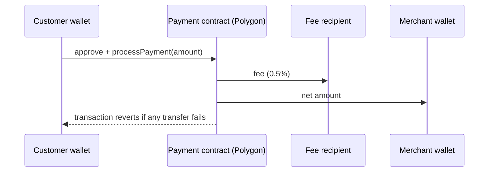

# Security model

How AneePay handles funds, fees, and trust boundaries — the system-level view.
Contract-level properties are in
[Security for developers](../developers/security.md); your own checklist is in
[Security best practices](best-practices.md).

## Non-custodial payments

AneePay never holds payment funds. A payment is one on-chain transaction: the
customer's tokens go from their wallet to the platform fee recipient and the
merchant's wallet inside the same call to the payment contract.

Properties that follow from this design:

- **No hosted balance for payments.** There is no account of ours that holds
  payment amounts, so payment funds cannot be frozen or withdrawn by the
  platform.
- **Atomic settlement.** Fee and net amount are sent in one transaction. If
  either transfer fails, everything reverts — there is no partial state.
- **Finality.** On-chain settlement cannot be reversed by AneePay: there are
  no refunds and no customer cancellation — see
  [Refunds and non-features](../payments/refunds-cancellations-and-non-features.md).
- **Customer gas.** The customer pays network fees in POL from their own
  wallet; the platform's only charge is the on-chain fee.

## On-chain fee

The 0.5% (50 basis points) fee is computed **by the contract at settlement
time** using integer math and paid to the platform's fee recipient in the same
transaction. You never send the fee yourself, and you can verify it from the
`feeAmount` and `netAmount` fields of the `PaymentProcessed` event, the webhook
payload, and `GET /payments/{id}`.

Rules and an example: [Networks, tokens, and fees](../payments/networks-tokens-fees.md#fees).

## Verified contracts

Every deployed contract's source is verified on the block explorer, so the
bytecode at the published addresses matches the published source. You can
independently confirm:

1. the address (table in
   [Contracts overview](../developers/contracts/index.md));
2. the verified source on the explorer;
3. the fee constants (`50` / `10000`) and the fee recipient in that source.

!!! warning "Verification is not an audit"
    Explorer verification proves source-to-bytecode integrity only. It does
    not certify contract logic. Evaluate the properties in
    [Security for developers](../developers/security.md).

## Trust boundaries

| You can rely on | You must protect |
| --- | --- |
| On-chain settlement rules (fee, atomicity, replay protection) | Your server secrets: `webhook_secret`, `X-Account-Id` |
| Public payment status via `GET /payments/{id}` | Your admin dashboard and CMS credentials |
| Webhook signature `X-AneePay-Signature` (HMAC-SHA256) | Where customer data appears in `description` |
| RFC 7807 error codes and `request_id` | Your handling of retries — make it idempotent |

What belongs on your side of the line: [Security best practices](best-practices.md).

## Reporting

Security problems in the API, checkout, contracts, or plugins go through
[Vulnerability disclosure](vulnerability-disclosure.md).

## Related sections

- [Security for developers](../developers/security.md)
- [x402 security](../x402/security.md)
- [Payments security and privacy](../payments/security-and-privacy.md)
- [Terms and privacy](../legal/terms-and-privacy.md)
