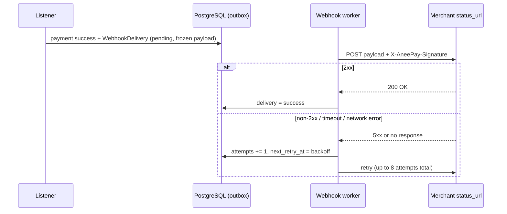

# Webhooks overview

AneePay notifies your backend about completed payments with signed **server-to-server
webhooks**. A webhook is the primary status channel: it is emitted only after the
on-chain payment is confirmed, carries the final numbers (fee, net amount, transaction
hash), and is retried from a durable outbox until you acknowledge it.

Polling [`GET /payments/{id}`](../payments/status-and-polling.md) works too, but webhooks
remove polling lag and the need to correlate on your schedule.

## When a webhook is sent

A webhook is created **only when a payment reaches `success`** — after the transaction is
confirmed on-chain (12 confirmations by default, see
[Payment lifecycle](../getting-started/payment-lifecycle.md)). There are no webhooks for:

- `pending` payments;
- `failed` payments (the customer is redirected to `fail_url`; poll the API if you need
  failure details);
- payments without a configured `status_url` on the account;
- cancellations — there is no customer-facing cancel path
  (see [Non-features](../payments/refunds-cancellations-and-non-features.md)).

## Delivery pipeline

Outbox pattern: the delivery record is written in the same database transaction that
marks the payment `success`, then sent by a separate worker. A crash or endpoint outage
never loses the event — the sweeper keeps retrying.

Key properties:

| Property      | Value                                                                        |
| ------------- | ---------------------------------------------------------------------------- |
| Direction     | Server-to-server: AneePay → your `status_url`                                |
| Method        | `POST`, `Content-Type: application/json`                                     |
| Auth          | `X-AneePay-Signature` header — HMAC-SHA256 of the raw body (see next page)    |
| Payload       | Versioned contract `v1` — see [Payload and signature](payload-and-signature.md) |
| Success       | Your endpoint must answer any **2xx** within 10 seconds                      |
| Retry policy  | Up to 8 attempts, exponential backoff — see [Delivery and retries](delivery-retries-idempotency.md) |
| Guarantee     | **At-least-once**; duplicates are possible, handle them idempotently by `event_id` |
| Scope         | No `account_id` in the payload — identify the payment via `event_id` / `operation_id` |

## What you must handle

1. **Verify the signature** on every request before trusting the body —
   [Payload and signature](payload-and-signature.md).
2. **Respond 2xx fast.** Do the heavy work (order fulfillment, DB writes) asynchronously;
   the sender times out after 10 seconds and will retry anyway.
3. **Be idempotent.** The same `event_id` may arrive more than once (retries, operator
   replay). Deduplicate by `event_id` — see
   [Delivery and retries](delivery-retries-idempotency.md).
4. **Gate real-world actions on `is_sandbox`.** Sandbox webhooks are indistinguishable
   in shape from production ones except for `is_sandbox: true` and `network: "amoy"`.
   Never ship real goods or credit real balances on sandbox events.

## Webhook vs polling vs redirect

| Channel                    | reliability | final numbers        | use                                        |
| -------------------------- | ----------- | -------------------- | ------------------------------------------ |
| Webhook (`status_url`)     | high (retries) | fee, net, tx hash  | primary — fulfill the order                |
| Polling `GET /payments/{id}` | high      | payment details      | fallback, backfills, unknown-outcome cases |
| Browser redirect (`success_url` / `fail_url`) | low | none | UX only — the customer can close the tab |

!!! warning "Never fulfill an order on browser redirect alone"

    `success_url` is a browser navigation the customer controls. Treat it as a UX
    signal; fulfill only after a verified webhook or a confirmed API read.

## Sandbox

Sandbox payments (`?sandbox=yes` at payment creation) produce real webhooks from the
Amoy testnet listener — with `network: "amoy"` and `is_sandbox: true`. This is the
recommended way to test your endpoint end-to-end. See
[Testing and replay](testing-and-replay.md) and [Sandbox](../sandbox.md).

## In this section

- [Payload and signature](payload-and-signature.md) — the v1 contract and verification.
- [Delivery, retries, idempotency](delivery-retries-idempotency.md) — outbox, backoff,
  what at-least-once means for you.
- [Testing and replay](testing-and-replay.md) — local setup, sandbox drills, common
  failures.
