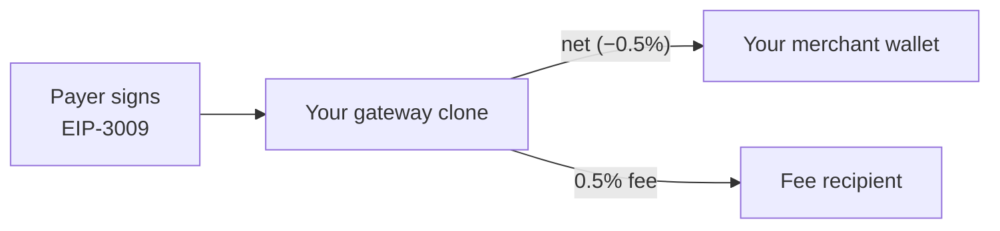

# Gateway contracts

Every AneePay account gets its own **gateway clone**: a small per-merchant
contract that receives x402 payments, withholds the 0.5% protocol fee, and
transfers the net amount to the merchant's wallet — all in one transaction.
This is the non-custodial core of x402: neither the SDK, the facilitator, nor
AneePay ever holds merchant funds or merchant keys.

## Per-merchant clone

| Property   | Detail                                                                            |
| ---------- | --------------------------------------------------------------------------------- |
| Pattern    | Minimal proxy clone pointing at a shared implementation                           |
| Deployment | Deployed by the factory, with the salt derived from your account id               |
| Address    | **Deterministic and public** — returned by `GET /x402/merchant` before deployment |
| Lifecycle  | Created lazily on your first successful settlement                                |
| Token      | One whitelisted ERC-20 per clone (USDC on Polygon mainnet)                        |
| Fee        | 0.5%, fixed at initialization                                                     |

Because the address is derived from your account id, it exists before the
contract does: you can put it into `PaymentConfig.pay_to` immediately, and the
payer's signature — `authorization.to = payTo` — is cryptographically bound to
**your** clone.

## Clone state

Fixed when the clone is initialized:

| Field          | Meaning                                                   |
| -------------- | --------------------------------------------------------- |
| `merchant`     | Your wallet address — the destination of every net payout |
| `feeRecipient` | Receives the 0.5% protocol fee on-chain                   |
| `token`        | The single accepted ERC-20                                |
| `factory`      | The factory that created this clone                       |

!!! warning "The merchant address cannot be redirected"

    `merchant` is fixed at initialization and the settlement call takes no
    recipient argument: the facilitator **cannot** redirect funds. Changing
    your payout wallet means moving to a new clone — contact support rather
    than expecting an on-chain switch on an existing clone.

## Mainnet addresses (Polygon, chain 137)

| Role           | Address                                      |
| -------------- | -------------------------------------------- |
| Implementation | `0x4Be1f3E654C44239757325BDb3d7a839178F782F` |
| Factory        | `0x7eAbb924A1f02B8f46d6cbDbC74a29444e09a877` |
| Fee recipient  | `0x0A53C0FAD64C55cEB35dd48774c6435bf9cB0009` |
| Token (USDC)   | `0x3c499c542cEF5E3811e1192ce70d8cC03d5c3359` |
| Fee            | 50 basis points (0.5%)                       |

These addresses are safe to verify against your own records: check that
`payTo` from `GET /x402/merchant` is deployed by this factory and that the
token matches what your offer advertises.

Amoy (chain 80002) has a token but **no factory**, so it is not serviceable
for settlement. `/x402/merchant` lists only networks that can actually settle;
in production that is `eip155:137`.

## Settlement

AneePay submits one of two settlement paths on your behalf:

| Function                                                                                               | Authorization type                                           |
| ------------------------------------------------------------------------------------------------------ | ------------------------------------------------------------ |
| `processPaymentWithAuthorization(operationId, from, value, validAfter, validBefore, nonce, signature)` | EIP-3009 `transferWithAuthorization` — the x402 `exact` flow |
| `settleWithPermit(operationId, from, value, permitData)`                                               | EIP-2612 / DAI-style permit                                  |

Both paths are reentrancy-protected and can be paused; settlement is only
executed by the AneePay service, never by an arbitrary caller. The factory
deploys and initializes a clone in a single atomic step, which prevents
front-running: nobody else can deploy a clone at your deterministic address
with their own `merchant` wallet.

On success the clone emits

```text
PaymentProcessed(operationId, payer, recipient, token, totalAmount, feeAmount, netAmount)
```

with the same signature as the standard payment event, so
[payment records and webhooks](../webhooks/overview.md) work the same way as
for every other AneePay flow.

## Non-custodial model



| Participant       | Holds                                                                            |
| ----------------- | -------------------------------------------------------------------------------- |
| Payer             | Signs `authorization.to = payTo = clone`, `value = amount`                       |
| Gateway clone     | Receives the transfer, splits fee and net in the same tx                         |
| Merchant wallet   | Receives net immediately — no withdrawal step                                    |
| Facilitator       | Only the ability to submit settlements; it cannot choose the recipient           |
| SDK / your server | No keys at all; only `X-Account-Id`                                              |

Compare with the hosted [CMS plugins](../cms/index.md): same account, same
non-custodial payout, different transport (redirect checkout vs. HTTP headers).

## Upgrades and new clones

The clone's implementation code is immutable, so an upgrade is never applied
in place:

- **Logic upgrades** ship as a new implementation and factory, which means new
  `payTo` addresses for new clones.
- Your existing clone keeps working with the implementation it was created
  with; existing settlement flows are not broken by an upgrade.
- Moving an existing account to a new clone is handled by support, because the
  `merchant` address is part of the clone's fixed state.

## Related sections

- [Facilitator API](facilitator-api.md) — how settlement is triggered.
- [Security](security.md) — the threat model built on these properties.
- [Developers](../developers/index.md) — developer resources and contract
  references.
