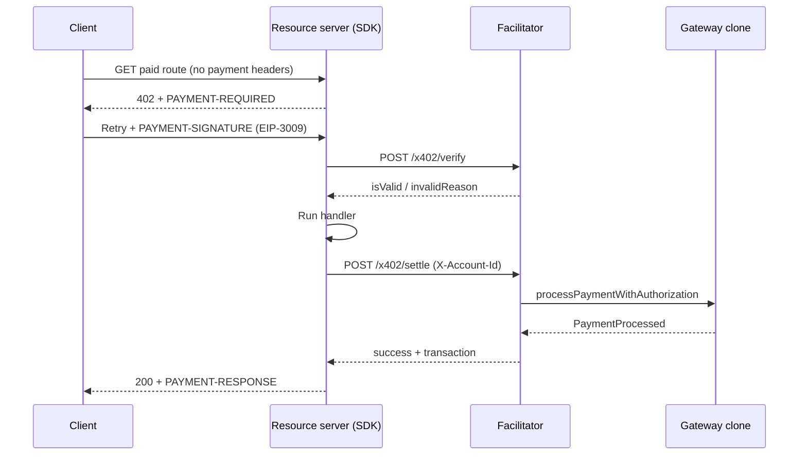

# x402

x402 is an HTTP-native payment protocol: instead of cards or checkout pages, a
server answers `402 Payment Required`, the client pays in cryptocurrency, and
retries the same request with proof of payment. AneePay implements x402 over
**wire v2**, the `exact` scheme, and **EVM** networks, so an API — including an
API called by AI agents — can charge per request in USDC without a browser.

The merchant-facing SDK **`aneepay-x402`** is **Production/Stable**: its public
API, known limitations, and support status are documented in this section.

!!! note "What x402 is not"

    This is not the hosted checkout used by shop plugins (see
    [CMS integrations](../cms/index.md)), and it is not the general payment API
    (see [API reference](../api/index.md)). x402 targets machine-to-machine
    HTTP traffic: agents, scripts, and service-to-service calls that never show
    a page to a human.

## Why a merchant needs it

- **Monetize API calls directly.** Price a route once (`0.05` USDC per report),
  and every successful call is settled on-chain before the response is
  returned.
- **No card rails, no chargebacks.** The payer signs an EIP-3009 authorization;
  settlement is an on-chain transfer.
- **Non-custodial.** Each merchant gets a dedicated gateway contract clone.
  Funds go from the payer to the clone and then to the merchant's wallet in the
  same transaction — AneePay never holds merchant keys. See
  [Gateway contracts](gateway-contracts.md).
- **Programmatic by design.** No redirects, no sessions: the whole flow is
  three HTTP headers and two facilitator calls.

## Actors

| Actor           | Who it is                                      | What it does                                                                                              |
| -------         | -----------                                    | --------------                                                                                            |
| Client          | An HTTP client: AI agent, script, service      | Requests a paid resource, receives `402`, signs the payment, retries with `PAYMENT-SIGNATURE`             |
| Resource server | Your application (SDK middleware)              | Prices the route, verifies the payment, runs the handler, triggers settlement, returns `PAYMENT-RESPONSE` |
| Facilitator     | AneePay service (`/x402/*` endpoints)          | Validates the signed authorization (`/verify`) and settles it (`/settle`) against the gateway             |
| Gateway clone   | Per-merchant EIP-1167 contract on an EVM chain | Receives the payment, withholds the 0.5% protocol fee, transfers the net to the merchant wallet           |

Only the resource server talks to the facilitator, and only it holds the
`X-Account-Id` account header. The client never calls AneePay directly.

## Before you start

You need three things, and you can get all of them before writing code:

| Requirement            | Where it comes from                                                                                 |
| ---------------------- | --------------------------------------------------------------------------------------------------- |
| AneePay account        | [Account setup](../getting-started/account-setup.md) — the account UUID is your `X-Account-Id`      |
| Gateway clone address  | `GET /x402/merchant` with `X-Account-Id` — use it as `pay_to`, **not** your own wallet              |
| A server you control   | Python 3.10+ with Starlette or FastAPI; the SDK is a `BaseHTTPMiddleware`-style dispatch            |

The payer needs a wallet that can sign an EIP-3009 authorization for the token
you accept. Clients that cannot sign cannot pay — there is no redirect or
browser fallback in this flow.

## Sequence

The full wire format, headers, and validation order are in
[Protocol and wire](protocol-and-wire.md).

## When to use x402

| Use x402 when…                                         | Use something else when…                                                                  |
| ----------------                                       | --------------------------                                                                |
| The caller is a machine: AI agent, cron job, service   | A human is shopping in a browser → [CMS integrations](../cms/index.md) or hosted checkout |
| You price per request or per payload in USDC           | You need a hosted page and a human payer → [Payment API](../api/index.md)                 |
| The caller can sign an EIP-3009 authorization          | The caller cannot hold a wallet                                                           |
| You control the HTTP server (Python/Starlette/FastAPI) | You cannot run middleware → consider the hosted flows                                     |

## SDK status

| Item     | Value                                                      |
| ------   | -------                                                    |
| Package  | `aneepay-x402` (PyPI; **not** the upstream `x402` package) |
| Status   | **Production/Stable**                                      |
| Language | Python 3.10+ (`httpx`, `pydantic`, `starlette`)            |
| Wire     | v2 only, scheme `exact`, EVM only (`eip155:<chainId>`)     |
| Install  | `pip install aneepay-x402` or `uv add aneepay-x402`        |

Known limitations — including deferred transports and version-skew behavior —
are listed in [Troubleshooting](troubleshooting.md#known-limitations).

## In this section

| Page                                      | Covers                                                                                           |
| ------                                    | --------                                                                                         |
| [Protocol and wire](protocol-and-wire.md) | Wire v2, `exact`/EVM, EIP-3009, the three `PAYMENT-*` headers, the full sequence                 |
| [SDK quickstart](quickstart-sdk.md)       | Installing `aneepay-x402`, `PaymentConfig`, protecting routes, per-route pricing                 |
| [Facilitator API](facilitator-api.md)     | `/x402/supported`, `/x402/merchant`, `/x402/verify`, `/x402/settle`, `X-Account-Id`, error codes |
| [Gateway contracts](gateway-contracts.md) | Per-merchant clone, factory, fee, non-custodial model                                            |
| [Testing](testing.md)                     | Testing middleware with `httpx.MockTransport` and a mock facilitator                             |
| [Security](security.md)                   | Replay protection, signatures, threat model, support status                                      |
| [Troubleshooting](troubleshooting.md)     | Verify/settle errors, `settlement_pending`, wrong network or amount, known limitations           |

## Related sections

- [API reference](../api/index.md) — base URL, authentication, error format;
  the x402 endpoints live on the same base URL.
- [CMS integrations](../cms/index.md) — the same AneePay account for
  storefront plugins.
- [Webhooks](../webhooks/overview.md) — settlement notifications for the
  resulting payment records.
- [FAQ](../faq.md) — short answers about x402, fees, and networks.
